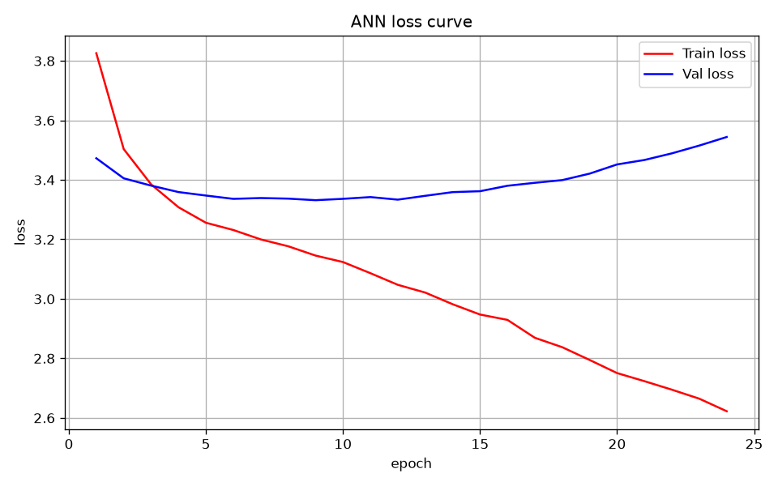
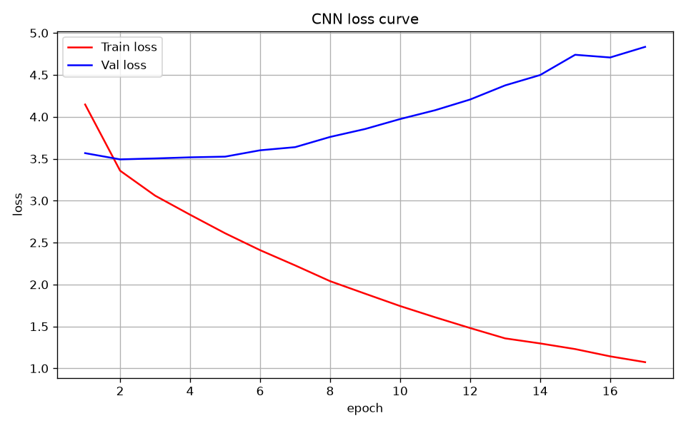
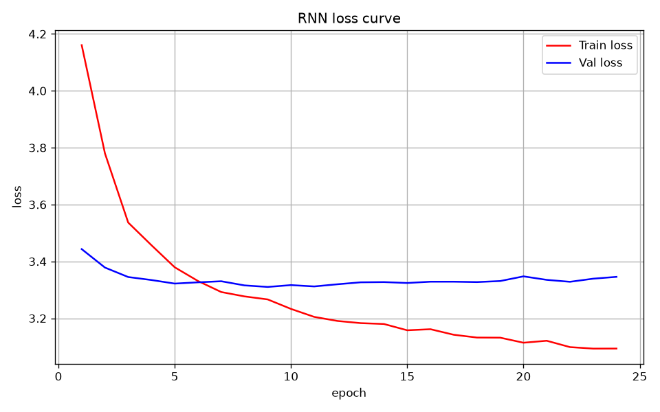
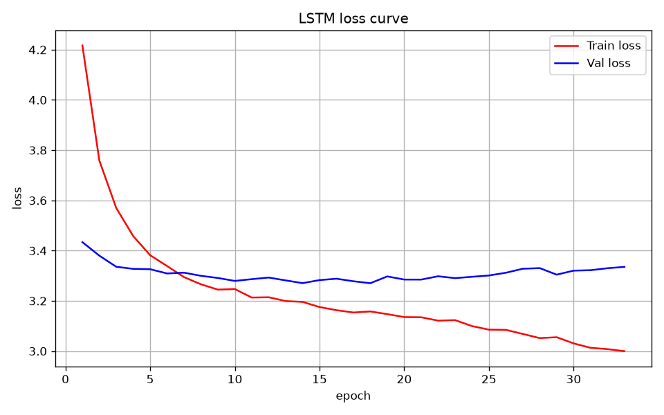
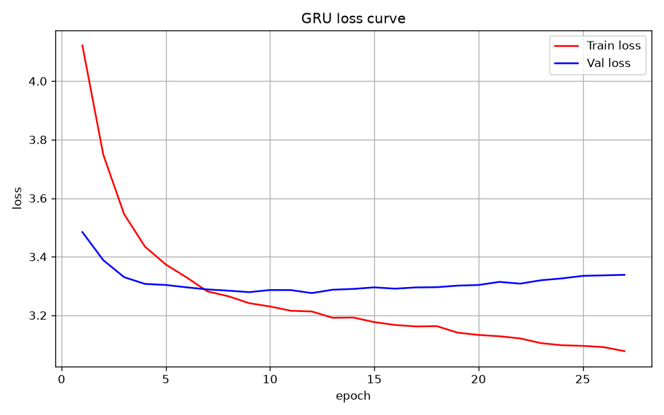
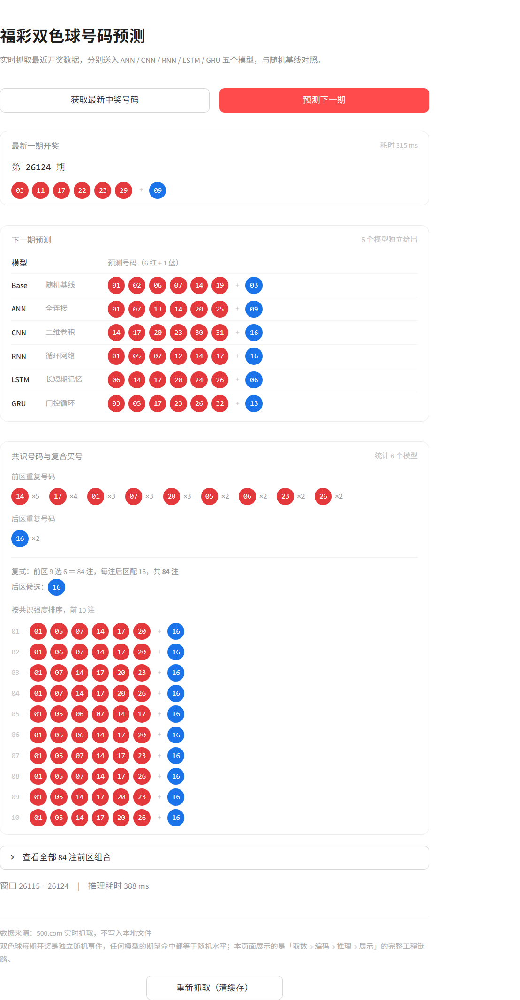

# 深度学习实战教程：福彩双色球预测

用福彩双色球的历史开奖数据，把「**数据处理 → 建模 → 训练 → 评估 → 部署**」这条深度学习工程链路完整走一遍。

项目里同时实现了 5 种模型（ANN / CNN / RNN / LSTM / GRU）和 1 条随机基线，用**同一份数据、同一套编码、同一个划分**做横向对比。

> ⚠️ **先看这一句**
> 双色球每期开奖是**独立随机事件**，任何模型都无法提高中奖概率。
> 本项目所有模型的实测指标都贴着随机基线（见下表），这**不是代码写错了**，而是数据的本质。
> 它的价值在于：用一条真实、完整、可运行的数据链路，讲清楚深度学习训练代码的每一部分在做什么。

---

## 一、先说结论：5 个模型的实测对比

数据：3521 期（2003 年第 001 期 ~ 2026 年第 124 期），滑动窗口 10 期，样本 3511 个，按时间 **8:1:1** 切分（2808 / 351 / 352）。

| 模型 | 参数量 | 最佳验证 loss | 早停轮次 | 前区平均命中 / 6 | 后区命中率 |
|---|---|---|---|---|---|
| ANN（全连接） | 75,249 | 3.3316 | 24 | 1.1023 | 5.68% |
| CNN（二维卷积） | 120,689 | **3.4922** | 17 | 1.1136 | 5.11% |
| RNN（循环） | 19,441 | 3.3102 | 24 | 1.0483 | 5.97% |
| LSTM | 66,481 | 3.2793 | 33 | 1.0852 | 4.83% |
| **GRU** | 50,801 | **3.2758** | 27 | 1.0994 | 5.40% |
| 随机基线 | — | 3.4657 | — | 1.0909 | 6.25% |

三个值得注意的现象：

1. **参数量越大，验证 loss 反而越差**。CNN 参数最多（12 万），验证 loss 甚至劣于随机基线；RNN 参数最少（1.9 万），表现最稳。这是"数据里没有信号"的典型指纹——容量越大，越早从"学习"转入"背诵"。
2. **6 个模型的前区命中全在 1.05~1.11 之间**，随机期望是 1.09。352 条测试样本下，这点差异完全在噪声范围内。
3. **验证 loss 先降后升**。训练 loss 一路往下走，验证 loss 在早期见底后持续上扬 —— 教科书级的过拟合。

### 5 张 loss 曲线放在一起看

红线是训练 loss，蓝线是验证 loss。

| ANN（75,249 参数） | CNN（120,689 参数） |
|:---:|:---:|
|  |  |

| RNN（19,441 参数） | LSTM（66,481 参数） |
|:---:|:---:|
|  |  |

| GRU（50,801 参数） | |
|:---:|:---:|
|  | |

五张图的形态完全一致：**训练线单向下行，验证线在开头见底后掉头向上，两条线的缺口越张越大**。
差别只在"多快"和"多狠"。

> 注意横轴刻度不同：CNN 只跑了 17 轮就早停，LSTM 跑了 33 轮。所以"后期上扬"在 CNN 图上被压缩在很短的一段里。

### 为什么每个模型都会过拟合

**共同的根因是：数据里没有信号。**

2808 个训练窗口，输入是 10 期号码，输出是下一期号码，两者之间不存在可学习的映射。
既然没有规律可学，模型的全部容量就只能用来记住训练集本身 ——
**容量越大、收敛越快，就越早开始"背题"。**

**ANN（490 → 128 → 64 → 32）**
训练 loss 从 3.83 降到 2.7 左右，验证 loss 在第 9 轮见底（3.3316）后回到 3.45。
490 维输入里有 60 个 1，网络把它当成一整块特征，"这 10 期长什么样"很容易被整块记住，
而模型结构里没有任何东西约束它不这么做。

**CNN（参数最多，12 万）**
最极端的那个：第 10 轮训练 loss 已经掉到 1.74，验证 loss 从 3.57 涨到 3.97，最佳权重落在第 1~2 轮。
卷积核天生擅长匹配局部图案，而 10×49 的输入里绝大多数格子是 0，
它很快就记住了训练集里那些特定的 0/1 分布。
**它甚至还没学会"输出历史频率"这一步，就已经开始背了** —— 这是它验证 loss 反而劣于随机基线的直接原因。

**RNN（参数最少，1.9 万）**
唯一一个训练 loss 掉得慢的，第 20 轮还停在 3.11。
隐状态每一步都要把历史压进一个 64 维向量，这个"瓶颈"反而限制了它背题的能力，
所以它的验证 loss 最平稳（3.3102）。**但代价是它同样什么都没学到**，指标照样贴基线。

**LSTM（6.6 万）**
两条状态、三个门。门控的本意是"选择记住什么"，
可当数据里没有值得记的规律时，**它选择记住的就是训练集的噪声**。
它是 5 个里训练最久的（33 轮才早停），说明它对训练集的拟合一直在改善。

**GRU（5 万）**
LSTM 的精简版，表现是 5 个里最好的（验证 3.2758），但也只比随机基线好 0.19。
它的曲线形态正好夹在 RNN 和 LSTM 之间 —— 这恰恰说明：**在这个任务上，模型结构先不先进根本不影响结论。**

> 一句话总结：**过拟合的严重程度基本跟参数量正相关，跟结构先不先进无关。**
> 换成一份真有信号的数据（销量预测、用户行为预测），这个排序会反过来。

---

## 二、快速开始

```bash
# 1. 安装依赖（CPU 用户建议先单独装 torch 的 CPU 版，见下方说明）
pip install -r requirements.txt

# 2. 启动后端（终端 1）
python _05_web/app_flask.py

# 3. 启动前端（终端 2）
streamlit run _05_web/app_streamlit.py
```

浏览器打开 <http://127.0.0.1:8501>，点两个按钮即可：

- **获取最新中奖号码** —— 实时从 500.com 抓取，不写 CSV
- **预测下一期** —— 抓最近 10 期 → 6 个模型各出一注 → 统计重复号并组合成复式买号

<p align="center">
  
</p>

> 仓库里已经带了训练好的 5 个模型（`_02_models/*.pth`，合计约 1.3 MB），
> 所以 clone 下来**不需要训练**就能直接预测。想自己练一遍再往下看。

### 关于 PyTorch

Windows 上直接 `pip install torch` 会拉 CUDA 版本（约 2.5 GB）。只用 CPU 的话：

```bash
pip install torch==2.14.1 --index-url https://download.pytorch.org/whl/cpu
pip install -r requirements.txt      # 已装好的 torch 不会重复下载
```

---

## 三、自己跑一遍

### 1. 更新历史数据（可选）

```bash
python _01_data/lottery_history.py
```

交互菜单里选第 2 项，会把全部历史开奖重新抓一遍并写入 `_01_data/fc_lottery_data.csv`。
每隔一段时间跑一次即可（每次开奖后线上的最新期会变）。

### 2. 逐个训练

```bash
python _03_train_models/_02_ANN.py
python _03_train_models/_03_CNN.py
python _03_train_models/_04_RNN.py
python _03_train_models/_05_LSTM.py
python _03_train_models/_06_GRU.py
```

CPU 上每个模型约 20~60 秒（含早停），5 个全部跑完 2 分钟左右。
每个脚本会自己保存 `_02_models/{模型名}_best.pth` 和对应的 loss 曲线。

### 3. 命令行预览预测结果（不开网页）

```bash
python _04_service/predict.py
```

会打印最新一期、喂给模型的 10 期、以及 6 个模型各自的预测号码。

---

## 四、目录结构

```
lottery/
├─ .env                       所有可调参数（路径、超参、端口），不含密钥
├─ config.py                  读 .env 并做类型转换、路径解析、参数校验
├─ requirements.txt           依赖（版本已锁定）
│
├─ _01_data/                  数据层
│  ├─ lottery_history.py     爬虫：最新一期 / 最近 N 期 / 全量更新 CSV
│  ├─ process_data.py        编码 + 滑窗 + 划分，所有模型共用
│  └─ fc_lottery_data.csv    历史开奖（3521 期，最新在上）
│
├─ _02_models/                训练产物
│  ├─ {ann,cnn,rnn,lstm,gru}_best.pth   5 个模型的参数（合计约 1.3 MB）
│  └─ *_loss.png                        5 张训练曲线
│
├─ _03_train_models/          训练脚本（每个都自带完整代码，可单独运行）
│  ├─ _01_Base.py            随机基线（不训练）
│  ├─ _02_ANN.py             全连接网络
│  ├─ _03_CNN.py             二维卷积
│  ├─ _04_RNN.py             循环网络
│  ├─ _05_LSTM.py            长短期记忆
│  └─ _06_GRU.py             门控循环
│
├─ _04_service/
│  └─ predict.py             加载模型 + 爬虫取数 → 6 组号码
│
└─ _05_web/                   前端（前后端分离）
   ├─ app_flask.py           提供 /latest、/predict、/health 三个接口
   └─ app_streamlit.py       页面：实时抓取 + 预测 + 共识号组合
```

> 文件名以 `app_` 开头是必须的：如果叫 `flask.py` / `streamlit.py`，
> 运行时会因为脚本所在目录排在 `sys.path` 最前面，导致 `import flask` 导入脚本自己。

---

## 五、关键设计

### 1. 训练样本怎么构造

一期开奖 → **49 维 one-hot**（前区 33 个位置 + 后区 16 个位置），连续 **10 期** 拼成一个样本：

```
X        (N, 10, 49)   10 个时间步，每步 49 维
Y_front  (N, 33)       前区多标签，一期 6 个 1
Y_back   (N,)          后区类别下标 0~15
```

同一份数据出两种形状，供给两类模型：

| 模型 | 输入形状 | 说明 |
|---|---|---|
| ANN | `(N, 490)` | 10 期首尾相接，期与期的边界靠位置隐式表达 |
| CNN | `(N, 1, 10, 49)` | 当成 10×49 的单通道"图"，卷积核看局部组合 |
| RNN/LSTM/GRU | `(N, 10, 49)` | 10 个时间步，`batch_first=True` |

样本数 = 3521 − 10 = **3511**。

### 2. 划分必须按时间

```
|<---- 训练 80% ---->|<-- 验证 10% -->|<-- 测试 10% -->|
旧                                                       新
```

不能随机打乱后划分——否则验证集会混进"未来"的数据，评估结果虚高。
（训练集内部用 `DataLoader(shuffle=True)` 打乱批次顺序，那是另一回事。）

### 3. 两个输出头、两个损失函数

```python
front_head: 32 → 33     多标签，BCEWithLogitsLoss     取 top-6
back_head:  32 → 16     多分类，CrossEntropyLoss      取 argmax
```

一次前向传播同时出两个头的 logits，两个 loss 相加后一次反向传播。

### 4. 训练和预测共用一条编码链

`_01_data/process_data.py` 是**唯一的编码入口**：

- `create_dataset_ann()` / `create_dataset_seq()` → 给训练用
- `make_predict_input(recent_draws)` → 给预测用

两者内部都调同一个 `encode_one_draw()`。这条纪律能避免一类很难查的 bug：
训练用一套编码、预测用另一套，**不报错，但结果全错**。

顺带一提，`make_predict_input()` 内部会把爬虫返回的"最新在前"翻成"最旧在前"。
忘了这一步，模型看到的是倒序序列，同样不报错，同样全错。

### 5. 早停

验证 loss 连续 `PATIENCE`（默认 15）轮不下降就停止训练，并保留验证 loss 最低的那一版权重。
本项目里循环网络（RNN/LSTM/GRU）通常在第 9~12 轮见底，CNN 更快（第 1~2 轮就见底），
所以最终保存下来的往往不是最后一轮的模型。

---

## 六、常用配置

全部在 `.env` 里改，改完**重启进程**生效：

| 配置项 | 默认值 | 说明 |
|---|---|---|
| `WINDOW_SIZE` | 10 | 滑动窗口长度。**改了必须重新训练**，否则模型输入维度对不上 |
| `EPOCHS` | 100 | 最大训练轮数（通常会被早停提前结束） |
| `BATCH_SIZE` | 32 | 批次大小 |
| `LEARNING_RATE` | 0.001 | 学习率 |
| `DROPOUT` | 0.5 | 丢弃率，彩票数据极易过拟合，所以取得偏大 |
| `PATIENCE` | 15 | 早停耐心值 |
| `FLASK_PORT` | 5000 | 后端端口 |
| `STREAMLIT_PORT` | 8501 | 前端端口 |

---

## 七、常见问题

**Q：页面报 `502 Bad Gateway`，但接口明明在跑？**
本机请求被系统代理拦截了。装了 Clash / V2Ray 的用户经常遇到——报错信息里完全看不到"代理"两个字。
`app_streamlit.py` 里已经对本地请求显式绕过代理（`proxies={"http": None, "https": None}`）。
如果你自己写了调用代码，记得加上这一段。

**Q：启动报 `Port 8501 is not available`？**
端口被占用了。要么关掉之前的进程，要么换端口：`streamlit run _05_web/app_streamlit.py --server.port 8502`。

**Q：`NotFoundError: removeChild`？**
页面里的原始 HTML 必须用 `st.html()` 渲染，不能用 `st.markdown(..., unsafe_allow_html=True)`——
浏览器会把 `<style>` 节点挪位置，Streamlit 重跑时 React 找不到原来的子节点就会抛这个错。

**Q：把 `WINDOW_SIZE` 从 10 改成 20，为什么预测报错？**
模型是按 10 期训练的，输入维度是 490。改成 20 后输入变成 980，形状对不上。
必须用新的窗口长度重新训练 5 个模型。

**Q：没有显卡能跑吗？**
能。全部代码在 CPU 上跑完只需几分钟，项目里没有大模型。

**Q：为什么模型每次刷新出来的号码不一样？**
`Base` 是随机基线，每次调用都重新摇号。它的存在是为了说明"神经网络并没有比随机更好"。

---

## 八、写在最后

这个项目最想传达的一件事：**loss 低 ≠ 有预测能力**。

上面那些 loss 曲线里，CNN 的训练 loss 从 4.1 一路降到 1.3，看起来"学得很好"；
但验证 loss 在第 9 轮就见底了，之后一路上扬——模型记住的是训练集里那 2808 个窗口的具体样子，
而不是任何能推广到下一期的规律。

如果换成一份真有信号的数据集（比如销量预测、用户行为预测），同样的代码结构会让你看到
"训练 loss 下降、验证 loss 也下降"的健康曲线。这也是为什么值得把它完整写一遍：
**学会分辨"学到了"和"背下来了"，比记住某个 API 重要得多。**

---

## 环境

- Python 3.12 / 3.13
- PyTorch 2.14（CPU 或 CUDA 均可）
- 实测于 Windows 11
- 依赖版本见 `requirements.txt`（已锁定）

## 免责声明

本项目仅用于深度学习教学与技术演示，**不构成任何投注建议**。
彩票属于概率游戏，请理性对待，量力而行。
历史数据来自公开网站，仅用于学习研究。
